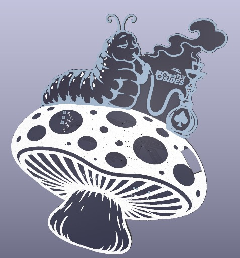
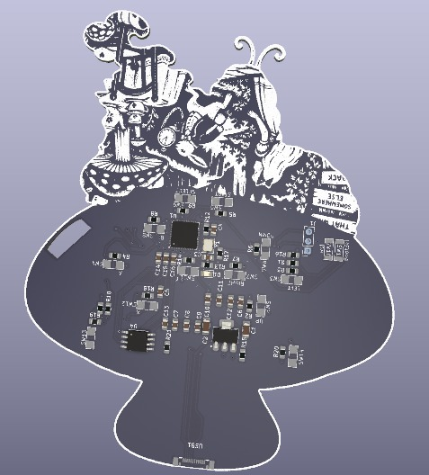
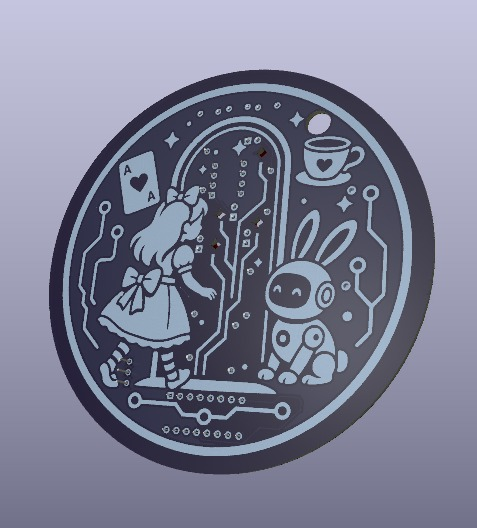

# BSidesTLV 2026 Badge

Everything for the BSidesTLV 2026 badge: two KiCad boards, the RP2040 firmware
that runs on it, and the online puzzle challenge — *Alice in AI Land* — that the
badge is used to play.

<p align="center">
  
</p>

```
index.html         the challenge - static site, served from the repo root
glitch.html        the glitch range - two practice rooms for the badge's quick-glitch layer
flash.html         flash the badge from the browser - WebUSB to the RP2040's bootloader
badge.html         the badge's vault - read it, provision it at the booth, try the beacon
robots.txt  rabbit-hole/   what crawlers get: a refusal, and a walkthrough that never ends
styles.css  src/  stages/  assets/
hardware/          KiCad projects (CERN-OHL-S-2.0)
  badge/             "BSidesTLV2026 Alice Controller" - RP2040 handheld, 14 buttons, USB-C
  soldering-kit/     555 + CD4017 LED chaser, the soldering workshop kit
software/          everything that builds the above, but is not served (MIT)
  controller/        RP2040 firmware - enumerates as a DualShock 4
  tools/             slicing and generation, writes into ../assets/
  references/        the source sheets the art was cut from
  legacy/  docs/
```

## The challenge

*Alice in AI Land* is a boulder-pushing puzzle game whose answer is a **program**.
Five stages. The first two are played by hand on the badge. Stage 3 is a
wall: the board is hidden before a human could read it and the move budget
exceeds human input bandwidth, so the only way through is to drive the game with
a script. The game hands you the protocol in stage 2 and dares you to use it.

The simulation is deterministic — 60 ticks/second, one input bitmask per tick,
same seed plus same input trace gives the same outcome byte for byte — which is
what makes it scriptable, replayable and verifiable.

It lives at the repository root — `index.html`, `glitch.html`, `flash.html`,
`badge.html`, `styles.css`, `src/`, `stages/`, `assets/`, `robots.txt` and
`rabbit-hole/` — as plain static files. No server, no build step, every path
relative, so it works at a domain root or under `/<repo>/` unchanged.

**The badge is the key.** On the published site nothing plays from a keyboard
or a screen: a gate asks for the badge first — *Connect* over WebHID in
Chrome or Edge, or hold `SELECT`+`Y` on the badge and it spells its vault on
the stick axes for any browser with a Gamepad API, phones included. The vault
is a 32-byte stage key written at the booth; the stages that matter are
sealed under it (`src/seal.js`, `npm run seal`), so a crawler, a script or a
model reading this site gets ciphertext. Unplug the badge and the page pauses
with it — the gauntlet's clock, a solver's playback, the range's pad — and
the gate comes back for the same badge. `badge.html` reads and provisions
it. What this stops, what it does not, and the server tier beyond it:
[`software/docs/BADGE_GATE.md`](software/docs/BADGE_GATE.md). Crawlers also
meet `robots.txt`, `noai` tags and a rabbit hole they can follow for as long
as they like.

```
./serve.sh          # http://localhost:8080, the same files Pages serves
npm run verify      # proves both stages are solvable, the range is honest, the flasher and the badge gate behave
npm run seal -- path/to/stage.js   # ALICE_STAGE_KEY=<64 hex>: seal a stage into stages/sealed/
```

On `localhost` there is no gate and the keyboard works, because that is
where the pages are developed; `?gate=1` brings the gate up there to try it.

### The glitch range

`glitch.html` is the training ground for the badge as a *fault-injection* and
*side-channel* tool. Three rooms, each with levels that start hand-playable and
end badge-only:

- **The Rabbit's Pocket Watch** — a fixed tune of buttons to enter inside a
  window. Level 1 is 4 presses in 2 s; level 4 is 12 presses in 600 ms, three
  times what a hand sustains. Record the tune slowly on the badge, speed it up.
- **The Looking-Glass Glitch** — the Queen's guard runs a routine one line per
  tick and one line is the check that turns Alice away. A pulse on `X` whose
  rising edge lands on that line skips it: the door opens and Alice jumps to
  the treasure. Every other landing is reported as a measurement — which line,
  how many lines and milliseconds off — and the last level hides the source so
  the only way in is to sweep the offset and read the guard's reactions.
- **The Caterpillar's Lock** — a door that checks a password one symbol per
  tick and stops at the first wrong one, so the time it takes to say *no* is
  how many symbols you had right: a timing side channel. Level 1 is read off
  the clock by hand; level 2 jitters, so a guess is recorded once and fired
  on repeat while the page keeps the median; level 3 compares in a secret
  order and still leaks, because a secret order is not constant time.

On a local checkout the page works from the keyboard too, which is how you find
out that level 3 of each cannot be done that way. `software/tools/verify-range.mjs`
checks exactly that: hand levels fit a hand, badge levels do not, and every
level is winnable.

The badge is a grip the phone sits in, so a phone held the other way up turns
the whole controller over. The page notices and turns the badge's buttons
back: UP/DOWN, LEFT/RIGHT, A/Y and B/X swap, the shoulders and START/SELECT
stay. Nothing changes on the badge. Two things tell it: the screen, when the
OS rotated the page to a "secondary" orientation, and the page turn below
when it did not. `?flip=1` / `?flip=0` pins the buttons either way for
testing.

### The page turns with the phone

A phone held upside down shows its page upside down: an iPhone, a Samsung
and most other Android phones never rotate a portrait page a half turn. What
the OS does instead depends on auto-rotate. Locked, it leaves the page on its
head. Unlocked, it turns the page to landscape as the phone passes a quarter
turn and leaves it there, since that is as far as it goes - so a player who
turns the phone right over sees the page on its side, stuck at the quarter
turn. Every page here rights itself either way. From the moment a page
loads, `src/tilt.js` reads the orientation sensor (`deviceorientation`'s
beta and gamma, which both platforms agree on, where `devicemotion`'s
gravity sign differs between iOS and Android) and decides whether the *phone*
is upside down, whatever the OS did with the page: past 150° it is, back
under 30° it is not, and a phone lying flat has no opinion, so the page does
not flap while it is waved about. When it is, the page gets the turn the OS
left undone: `data-flip` on `<html>` is `180` where the OS did nothing, `90`
or `270` where it stopped at landscape, and nothing at all on the phones that
do turn a page upside down. `styles.css` turns the whole view by it: header,
panels, the mode bar, the bottom sheet, the on-screen pad, the canvases and
every dialog, in every look and theme, with the safe-area insets and the
scrolling following the player's up; for a quarter turn the page is laid out
as tall as the landscape viewport is wide, and the phone breakpoints hold
though the viewport is wide. When the OS turns the page while the phone is
upside down (to the other landscape, or back to portrait as the phone comes
round) the turn is redone at once from the same reading. It needs no badge,
no gate and no pad; it is the same on every page. Android needs no tap. iOS
shares the sensor only after a tap asks, and the first tap on anything
sensible asks: the page-turn icon, the ◐ chip, a switch, the gate's Connect
button, the on-screen pad.

The control is a small icon beside the ◐ chip in every header, a phone with
an arrow round it. It shows the state - dim on auto, lit while the page is
turned, filled on *yes*, struck through on *no* - and a small dot while iOS
still has to be asked for the sensor (red once refused). A tap on it is the
gesture iOS wants, so the prompt comes from the icon itself, and opens a
popover under it: one line on what the turn is and the hand switch, *auto /
no / yes* - for a phone without a sensor, a browser that refused it, or a
player who wants the page their way. The ◐ sheet carries the same switch as
a row. Either way it is remembered on the device as `alice.flip` and honoured
before the first paint, by the same arithmetic (a half turn, or a quarter
when the page is in landscape). On a touch screen the popover opens once by
itself, as a tip, on the first visit (`alice.flip.tip`; `?tip=1` / `?tip=0`
force it either way), goes on any tap outside it and never comes back; a
switch set by hand means no tip. It is not a dialog: nothing waits on it. The
badge's buttons follow the same decision, so the switch never has to be set
for the controller separately. `software/tools/verify-badge.mjs` checks the
sensor maths, the turn for each thing the OS may have done, the hysteresis,
the switch, the listener from load and the permission paths;
`verify-looks.mjs` checks the rules, the boot script, the icon on every page
(before the chip, labelled, with its popover and states), the sheet's row,
the tip's gating and that every page reaches the module.

Every page has a theme and a look — the ◐ chip in the header opens a sheet of
cards (the ? panels show the same cards), or `?theme=` and `?look=` in the
address bar; both are remembered on the device. The theme is what the page is
painted in: `bsides`, the conference's own lime on black (the default);
`classic`, the first deep-blue console; `teaparty`, parchment in daylight;
`queen`, heart red and gold; `cheshire`, magenta and a teal grin; `phosphor`,
green on black with scanlines. The look is how it sits on the screen: the
classic look is the whole page; the three phone looks — `bench`, `handheld`,
`scope` — show one panel at a time behind a mode bar (on the stages: Tea,
Gauntlet, Walk, Art; on the range: Watch, Glass, Lock, Bench), fold the prose
behind *how it works*, and on the range reshape the on-screen pad — a bottom
sheet, a handheld's body with the screen in a bezel, or a dock of soft keys
under big numerals — and draw the guard's routine and the door's clock as
tick traces. On the published site that pad is a mirror of the badge's
buttons, never a controller. A theme is one file in `src/themes/` plus a line
in `src/themes/index.json`, a look the same in `src/looks/`; every colour in
`styles.css` is a variable a theme overrides, so adding either touches nothing
else.

[`.github/workflows/pages.yml`](.github/workflows/pages.yml) stages those
paths, cross-builds the firmware into `firmware/` beside them (so `flash.html`
always offers the image built from the commit it was deployed with), and
publishes the lot; set Settings -> Pages -> Source to "GitHub Actions" once
and pushes to `main` that touch the site deploy themselves. It stages rather
than uploading the repo so the artifact stays ~4MB instead of ~34MB —
`hardware/` and `software/` are not part of the site.

ES modules need `http://`, not `file://`. That is the only reason a local
server exists.

- [`software/README.md`](software/README.md) — asset set, slicing tools, how every sprite was cut
- [`software/docs/GAME_DESIGN.md`](software/docs/GAME_DESIGN.md) — stages, tick model, protocol

## The hardware

| Board | What | Key parts |
|---|---|---|
| [`hardware/badge/`](hardware/badge) | "BSidesTLV2026 Alice Controller" v0.4 — the badge itself, and the controller the challenge is played on. D-pad, A/B/X/Y, Start/Select, reset and BootSel, all on one side. Cut to the outline of the Caterpillar's mushroom. | RP2040, W25Q128JVS, AMS1117-3.3, USB-C |
| [`hardware/soldering-kit/`](hardware/soldering-kit) | Through-hole LED chaser for the soldering workshop. Beginner-friendly: DIP, axial, CR2032. | TLC555P, CD4017BE, 4x LED, 500k trimmer |

<table>
<tr>
  <td align="center" width="50%"></td>
  <td align="center" width="50%"></td>
</tr>
<tr>
  <td align="center"><b>badge, back</b> — the RP2040, flash, regulator and the button matrix</td>
  <td align="center"><b>soldering kit</b> — Alice, the White Rabbit and the looking glass</td>
</tr>
</table>

Each project carries its own `production/` directory with the fabrication
package: BOM, positions, designators and IPC netlist.

See [`hardware/README.md`](hardware/README.md) for opening, plotting and
re-fabricating the boards.

## The firmware

[`software/controller/`](software/controller) is the RP2040 firmware. It
presents the badge to a host as a **wired DualShock 4** (Sony's VID/PID; the
name is the badge's own), which is what makes it
work on an iPhone — iOS only binds controllers it recognizes by USB VID/PID, so
a generic HID gamepad enumerates and is then ignored. Every other host
understands the same report.

```
cd software/controller
mkdir build && cd build
cmake -DPICO_SDK_PATH=/path/to/pico-sdk ..
make -j                              # -> build/controller.uf2
```

Hold `BootSel` while plugging in USB-C, then copy `controller.uf2` onto the
`RPI-RP2` drive that appears - or let `python3 software/tools/flash-badge.py`
wait for the drive, copy, and confirm the controller came back (`--fetch`
takes the newest CI build, so no toolchain is needed). On this firmware,
`SELECT+START` held for two seconds reaches the bootloader without the button.
It also builds and runs on a stock Raspberry Pi Pico, which is the easiest way
to try the firmware without a badge.

Or from a browser: [`flash.html`](flash.html) on the site talks to the
bootloader over **WebUSB** — Chrome or Edge on a PC, a Mac, a Linux box or an
Android phone, nothing to install — and writes the image the deploy built.
It speaks PICOBOOT, the protocol `picotool` uses (`src/picoboot.js`), reads
the flash back before rebooting, and is tested against a model of the ROM by
`software/tools/verify-flash.mjs`.

**The vault.** The last flash sector holds the stage key the challenge site
is sealed under. HID feature report `0xF1` — one the DualShock 4 descriptor
already declares, so iOS is unaffected — reads and writes it; `SELECT`+`Y`
held spells it on the stick axes for browsers without WebHID. Writes to a
keyed badge need `SELECT` physically held. `software/controller/src/vault.c`,
host-tested by `test/test_vault.c`; the site side is `src/vault.js`, proven
against `software/tools/fake-badge.mjs`.

**Quick glitch.** `SELECT` is a shift key. `SELECT+SL` records a take of button
presses with microsecond timestamps; `SELECT+SR` fires it — a `START` tap as
the trigger, a wait of `offset`, then the take at `speed`. `UP`/`DOWN` scale
the speed from 1/4× to 32×, `LEFT`/`RIGHT` step the offset in milliseconds,
`B` forgets it all. It is what the glitch range is played with. The engine is
plain C with a host test: `make -C software/controller/test`.

Full pin map, chord table and HID report layout:
[`software/controller/README.md`](software/controller/README.md).

## Licences

- **Software** — MIT, see [`LICENSE`](LICENSE). Covers `software/` and the
  Python/Node tooling under `hardware/soldering-kit/tools/`.
- **Hardware** — CERN-OHL-S-2.0, see [`hardware/LICENSE`](hardware/LICENSE).
  Covers both KiCad projects and every gerber, plot and production package
  under `hardware/`.

Third-party symbols and footprints vendored under
`hardware/badge/libs/lcsc/` keep their own upstream terms.

## Contributing

See [`CONTRIBUTING.md`](CONTRIBUTING.md).
