# BSidesTLV 2026 Badge

Everything for the BSidesTLV 2026 badge: two KiCad boards, the RP2040 firmware
that runs on it, and the online puzzle challenge, *Alice in AI Land*, that the
badge is used to play. One badge is the controller, the key to the site and a
glitching tool, and anyone with a clone - or an AI with a shell - can build the
next room.

<p align="center">
  <a href="images/promo.mp4">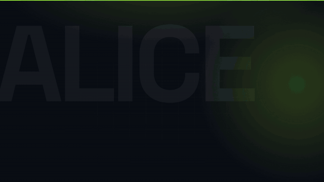</a><br>
  <sub>the short cut; <a href="images/promo.mp4">the full promo</a> is in <code>images/</code>, and <a href="software/promo/">software/promo/</a> is how it was made</sub>
</p>

```
index.html         the stages - the level explorer, every room, the prizes, the tutorial "A Caucus Race"
glitch.html        the glitch range - five rooms for the badge's quick-glitch layer, the tutorial "Down the Rabbit Hole"
flash.html         flash the badge from the browser - WebUSB to the RP2040's bootloader
badge.html         the badge's vault - read it, provision it at the booth, try the beacon
maker.html         the level maker - the invitation on the site, the studio and a simulated badge on a checkout
robots.txt  rabbit-hole/   what crawlers get: a refusal, and a walkthrough that never ends
styles.css  src/  stages/  assets/
hardware/          KiCad projects (CERN-OHL-S-2.0)
  badge/             "BSidesTLV2026 Alice Controller" - RP2040 handheld, 14 buttons, USB-C
  soldering-kit/     555 + CD4017 LED chaser, the soldering workshop kit
software/          everything that builds the above, but is not served (MIT)
  controller/        RP2040 firmware - enumerates as a DualShock 4
  tools/             the slicers, the generators, every verifier CI runs, the maker's server and MCP bridge
  promo/             the promo video and the README's GIFs, recorded off the real pages
  references/        the source sheets the art was cut from
  docs/              the game design, the badge gate, the level maker, what a model does to a site
images/            the photos and animations this README shows - not published
```

<p align="center">
  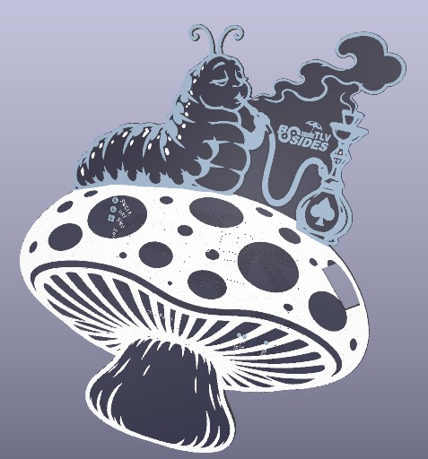
  
</p>

## The challenge

*Alice in AI Land* is a boulder-pushing puzzle game whose answer is a
**program**. Five stages. The first two are played by hand on the badge. Stage
3 is a wall: the board is hidden before a human could read it and the move
budget exceeds human input bandwidth, so the only way through is to drive the
game with a script. The game hands you the protocol in stage 2 and dares you
to use it. The simulation is deterministic - one input per tick, same seed
plus same input trace gives the same outcome byte for byte - which is what
makes it scriptable, replayable and verifiable. The design of all five:
[`software/docs/GAME_DESIGN.md`](software/docs/GAME_DESIGN.md).

The site is plain static files at the repository root - `index.html`,
`glitch.html`, `flash.html`, `badge.html`, `maker.html`, `styles.css`, `src/`,
`stages/`, `assets/`, `robots.txt` and `rabbit-hole/`. No server, no build
step, every path relative, so it works at a domain root or under `/<repo>/`
unchanged.

```
./serve.sh          # http://localhost:8080, the same files Pages serves
npm run maker       # the same, in Node alone, and opens the level maker with the assistant's bridge
npm run verify      # solves every stage, attacks the range, flashes a fake ROM, drives a fake badge, the maker and the community's levels, proves the obfuscated tree behaves - CI's gate before every deploy
npm run stage -- stages/community/<id>.js   # the verdict CI will reach on one level
npm run seal -- path/to/stage.js   # ALICE_STAGE_KEY=<64 hex>: seal a stage into stages/sealed/
```

On `localhost` there is no gate and the keyboard works, because that is where
the pages are developed; `?gate=1` brings the gate up there to try it.

### The badge is the key

On the published site nothing plays from a keyboard or a screen: a gate asks
for the badge first - *Connect* over WebHID in Chrome or Edge, or hold
`SELECT`+`Y` on the badge and it spells its vault on the stick axes for any
browser with a Gamepad API, phones included. The vault is a 32-byte stage key
written at the booth; the stages that matter are sealed under it
(`src/seal.js`, `npm run seal`), so a crawler, a script or a model reading
this site gets ciphertext. Unplug the badge and the page pauses with it - the
gauntlet's clock, a solver's playback, the range's pad - and the gate comes
back for the same badge. A controller that is not the badge (a stock
DualShock 4, or a badge on the stock firmware) is told so and sent to
`flash.html`, which is never gated. `badge.html` reads and provisions the
vault.

Every page that asks for a press shows where it goes: the badge drawn from the
board itself (`src/badge-shape.js` is generated from the KiCad file by
`gen-badge-art.mjs`; `src/prompt.js` draws it as the player holds it, the back
of the board with the stalk up), the asked-for buttons lit and rippling, a hold
as a filling gauge, and a pointing hand on whatever control is next. The gate,
the flash page, the vault page, both tutorials and a room's lesson use the same
pictures. What the gate stops, what it does not, and the server tier beyond
it: [`software/docs/BADGE_GATE.md`](software/docs/BADGE_GATE.md).

### The stages

<p align="center">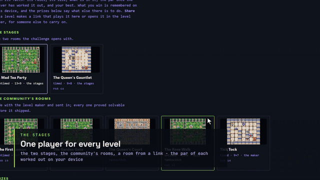</p>

`index.html` is a level explorer. One player plays whichever level is open by
its rules - *A Mad Tea Party* (13x9, untimed: three rocks, three buttons, a
gate and its lever, par 106), *The Queen's Gauntlet* (9x8, timed at 320 ms a
tick with three periodic hazards, par 64 ticks), every room the community
made, a room that came in a link - with the level's name and who made it, a
facts strip (rules, size, what is in it, the par once known with a difficulty
word from "a stroll" to "a nightmare", your best), the blurb, the legend, the
lesson the room may carry, Undo / Reset or Restart, **Share** and a status
line that says why a push did not happen. **Levels** below is the catalogue:
the two stages, the community's rooms, *Shared with you* - a card per level
with the room drawn small, its kind, size and author, `par N` once the page
has worked it out (a worker solves every level once per device; The Queen's
Court is beyond its search and stays unknown), `✓ best` once won, ★ when in
par. Then the **Prizes**: thirteen, none hidden, each a test over what you
did - *Down the rabbit hole* (a first step), *Tea is served*, *Not today, Your
Majesty*, *Seen* (caught), *The best known answer* (a win in par), *No regrets*
(untimed, no undo), *Standing still* (twenty waits), *A long walk* (five
hundred moves), *The first lesson* (a lesson followed to its end), *A caucus
race* (every community room), *A prize for everyone* (every level), *Through
the looking glass* (a shared room won), *The Caucus Race, run* (the tutorial).
Progress lives on the device (`alice.progress`, keyed by a hash of the room so
the same room shared, shelved or merged is one level); a win after Solve ran
earns nothing. **Share** writes the open level as a link in two forms - play it
here, or carry it on in the maker.

**A Caucus Race** is the tutorial, sixteen steps that watch what the player
does and tick themselves off, as a coach line above the panels and a checklist
in the *Learn* panel: chapter one is the tea party (wake, step, shove, lever,
button, undo, reset, win), chapter two the gauntlet (the first press starts
the clock, wait, get caught, restart, a button across the corridor, out),
chapter three a community room and its lesson. A step the player asks for
opens its stage; a step that completed itself leaves them where they are and
says where to go next. Play aids on every host: `B` or Backspace takes a move
back, the status warns when a rock is lost in a corner, a bump says why (the
gate is shut, find the lever; the door wants all three buttons held), and the
gauntlet's clock holds after every restart until the first input, so every run
starts on the beat the solver assumes.

### The glitch range

<p align="center">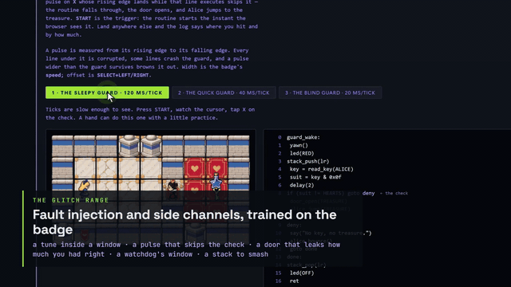</p>

`glitch.html` is the training ground for the badge as a *fault-injection* and
*side-channel* tool. Five rooms, each with levels that start hand-playable and
end badge-only, and a tutorial that walks them:

- **The Rabbit's Pocket Watch** - a fixed tune of buttons to enter inside a
  window. Level 1 is 4 presses in 2 s; level 4 is 12 presses in 600 ms, three
  times what a hand sustains. Record the tune slowly on the badge, speed it up.
- **The Looking-Glass Glitch** - the Queen's guard runs a routine one line per
  tick and one line is the check that turns Alice away. A pulse on `X` whose
  rising edge lands on that line skips it: the door opens and Alice jumps to
  the treasure. Every other landing is reported as a measurement - which line,
  how many lines and milliseconds off - and the last level hides the source so
  the only way in is to sweep the offset and read the guard's reactions.
- **The Caterpillar's Lock** - a door that checks a password one symbol per
  tick and stops at the first wrong one, so the time it takes to say *no* is
  how many symbols you had right: a timing side channel. Level 1 is read off
  the clock by hand; level 2 jitters, so a guess is recorded once and fired
  on repeat while the page keeps the median; level 3 compares in a secret
  order and still leaks, because a secret order is not constant time.
- **The Dormouse's Watchdog** - a *window* watchdog: the Dormouse sleeps as
  long as it is nudged every so often, and not too often. `START` puts it to
  sleep, every `A` must land inside the window measured from the nudge before,
  too soon stirs it and too late it bites. Level 1's window is half a second
  wide; level 3's is 40 ms, ten nudges a second, so the nudges are a take
  recorded at an easy tempo and played at 8x, with the first gap as the fire's
  offset.
- **Humpty Dumpty's Wall** - a stack overflow, one button at a time. Humpty
  reads Alice's name into a buffer with no bound; behind it sit his saved
  return address (two symbols) and, on the last level, a canary. A name that
  fits is politely received, one symbol more and the overflow begins: a wrong
  canary and he halts, a wrong address and he has a great fall, the address of
  `open_wall` from his listing and the wall opens. The size leaks where his
  answer changes, the canary where he is polite again, and the name is read
  with a per-symbol timeout the later levels make shorter than a thumb, so
  each name is a take.
- **Down the Rabbit Hole** - the tutorial: seventeen steps that watch what the
  player does and tick themselves off. Chapter one visits every range's hand
  level with any controller; chapter two is the badge (record and fire, speed,
  offset, repeat, one badge-only level per range). Progress is kept on the
  device, any step can be skipped.

Every level the community makes for a range (see below) becomes the last tab
of that range, and a level carried in a `?level=` link the tab after it. On a
local checkout the page works from the keyboard and an on-screen pad too,
which is how you find out that the last level of each range cannot be done
that way; `software/tools/verify-range.mjs` checks exactly that: hand levels
fit a hand, badge levels do not, every level is winnable (the lock and the
wall by a reference attacker), and the tutorial's steps name real levels.

### The badge in the phone

<p align="center">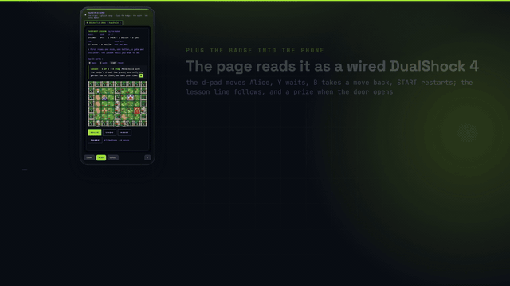</p>

The badge is a grip the phone sits in, plugged in over USB-C, and the page
reads it as a wired DualShock 4: the d-pad moves Alice, `Y` waits, `B` takes a
move back, `START` restarts. Held the other way up, the whole controller turns
over - so the page notices and turns the badge's buttons back (UP/DOWN,
LEFT/RIGHT, A/Y and B/X swap, the shoulders and START/SELECT stay; `?flip=1|0`
pins it for testing; nothing changes on the badge) and rights its own page too.
Phones never rotate a portrait page a half turn: with auto-rotate off the OS
leaves the page on its head, with it on the OS stops at landscape. From the
moment a page loads `src/tilt.js` reads the orientation sensor, decides on the
*phone's* own angle whether it is upside down (past 150° it is, back under 30°
it is not, a flat phone has no opinion) and sets the turn the OS left undone;
`styles.css` turns the whole view by it - header, panels, dialogs, the pad,
the safe-area insets, the scrolling - in every look and theme. The control is
a small icon beside the ◐ chip in every header (dim on auto, lit while turned,
filled on *yes*, struck through on *no*; a tap is also the gesture iOS wants
before it shares the sensor) with a popover and the hand switch *auto / no /
yes*, remembered on the device and honoured before the first paint. The badge's
buttons follow the same decision, so nothing has to be set twice.

### Make a room

<p align="center">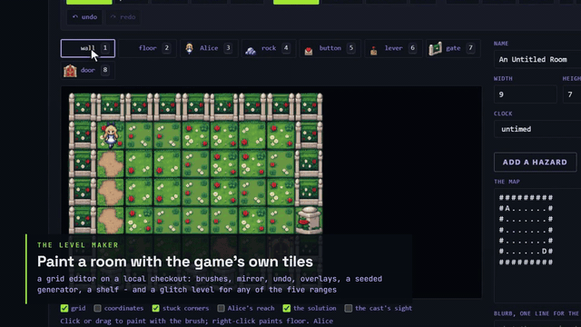</p>

A stage is a few lines of text, and anyone with a clone can write one. On a
local checkout `maker.html` is **the studio**: a grid editor drawn with the
game's own tiles - pencil, line, rectangle, fill and pick, mirror none / h / v
/ both, flip, turn, the four shifts (routes follow), undo and redo, zoom, the
palette on keys 1-8 - with overlays for the grid, the coordinates, the corners
a rock would be lost in, Alice's reach, the last solution's path and the
cast's sight; the map as text, size, dressing (garden, hall, court) and clock,
the hazards and their routes laid by clicks; six starters, every one proven;
**Surprise me**, a seeded generator with knobs (size, rocks, walls, a gate,
timed, a minimum par) that only hands back rooms the solver clears; a shelf.
**Check** runs the real solver in a worker: the par, whether the gate is
load-bearing or decoration, what the cast costs, a difficulty word. **Run &
debug** plays the room by its rules with a simulated badge that lights from
the keyboard, a click or a real badge on USB and logs every edge; *Play the
solution* walks it. **Open…** takes a shipped stage as a copy, one of the
community's levels, the shelf or a share link pasted in; the picker opens by
itself on a first visit. **Share** writes the room as one link - compact or
readable, with or without its lesson and blurb, opening in the maker or on the
stages page, `&play=1` straight into Run & debug. The export writes the stage
module, copies or downloads it, or opens the pull request below. Four guided
builds live in the *Learn* panel: *Painting the Roses* (the tour), *A Room with
a Gate*, *The Clock and the Cast* (a timed room) and *A Room that Teaches* (a
lesson); every step watches the studio's own events.

The same page has a second category: **a glitch level**, for any of the five
ranges, as data - a form per range (pools as checkboxes, the glass's routine
under its legend, Humpty's frame written out), the range's map and what the
rules make of the numbers, lint, a Check that runs what `verify-range.mjs`
runs on the shipped levels (hand or badge-only, the attacker's takes, every
note; a level that lies about its hand is refused as it is in CI), *Start
from…* the shipped levels as copies, and **Try it on the range**, which opens
`glitch.html` with the level as its last tab. The whole format and process:
[`software/docs/LEVEL_MAKER.md`](software/docs/LEVEL_MAKER.md).

### Build it with your AI

On the published site `maker.html` is the invitation: what a stage is, how to
get the maker, and **Try it now with your favourite AI**, which hands an
assistant the prompt - fork the repository first (so the room lands on your
own GitHub Pages site), run `npm run maker -- --no-open`, open the page in its
own browser pane, connect and say hello. The moment it does, the page pops the
**White Rabbit's welcome banner** with three ways to a first room: *Follow the
White Rabbit* (step by step: you hold the brush, it coaches, every step a
checklist item on the page), *Drink Me* (four questions - a name, a size, a
flavour, a dressing - and it generates, patches, checks and plays a room with
you, keep or roll again, harder or easier) and *Eat Me* (one of three
starters, one bite). Every question the assistant asks is also a card of
buttons on the page, with the step's *why*, what it is about to do and a **Do
it for me** button, so the person and the assistant stay in step whichever of
them answers. The guide is written down as data (`src/guide.js`: what to say,
what to ask, what to do, when it is done), served by the maker's bridge
(`/__maker/guide`) and as MCP tools (`maker-mcp.mjs`, 22 of them, registered
for Claude Code, Codex, Cursor, Gemini CLI, VS Code Copilot and Hermes by the
configs at the root; `AGENTS.md` is the short map an assistant reads first), so
anything with a shell can walk you through it.

The last step is the pull request. **Open a pull request with your AI** in the
export writes the brief: the module verbatim, the file and the index line, the
branch, `npm run stage` then `npm run verify`, one commit, the `gh pr create`
line or the compare URL, and the body with the par and the difficulty word once
Checked; Copy, Open in Claude or Open in ChatGPT carry it, and an assistant on
the bridge gets it in its inbox. One room per PR, nothing under `src/`, the
index kept sorted.

### The community

Rooms go in `stages/community/` with a line in its `index.json`; `npm run
stage -- <file>` says what CI will say, and `verify-maker.mjs` gates every
deploy on every listed level: a room solves and its lesson is followable, a
glitch level passes `rangeCheck`, agrees with its kind and takes no shipped
level's id. A merged room is playable on the stages page from **Levels**, a
merged glitch level on the range page as its range's last tab. Six are in so
far:

| Level | By | What |
|---|---|---|
| *The First Lesson* | the maker | the demo room: every rule of an untimed room once, with a lesson that follows the player |
| *The Garden Gate* | TikoTikTok | untimed |
| *The Rose Walk* | Gili Yankovitch | untimed |
| *The Queen's Court* | Gili Yankovitch | timed, beyond the explorer's solver |
| *Tick Tock* | the maker | the timed demo, with a lesson |
| *Which side?* | the maker | a lock level, the first community tab on the range |

A lesson is a few lines on the module that tick themselves off as the player
does what they say; the two demo rooms show the format. See
[`CONTRIBUTING.md`](CONTRIBUTING.md).

### Looks and themes

<p align="center">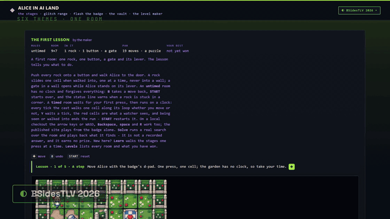</p>

Every page has a theme and a look - the ◐ chip in the header opens a sheet of
cards, or `?theme=` and `?look=` in the address bar; both are remembered on
the device. The theme is what the page is painted in: `bsides`, the
conference's own lime on black (the default); `classic`, the first deep-blue
console; `teaparty`, parchment in daylight; `queen`, heart red and gold;
`cheshire`, magenta and a teal grin; `phosphor`, green on black with
scanlines. The look is how it sits on the screen: `classic` is the whole page;
the three phone looks - `bench`, `handheld`, `scope` - show one panel at a
time behind a mode bar, fold the prose behind *how it works*, and on the range
reshape the on-screen pad (a bottom sheet, a handheld's body with the screen
in a bezel, a dock of soft keys under big numerals) and draw the guard's
routine and the door's clock as tick traces. On the published site that pad
is a mirror of the badge's buttons, never a controller. A theme is one file in
`src/themes/` plus a line in its `index.json`, a look the same in `src/looks/`;
every colour in `styles.css` is a variable a theme overrides.

### What a crawler gets

`robots.txt` turns the AI crawlers away (honoured at a host root, so inert on
a project page until a custom domain), every page carries `noai`, and a hidden
door leads to `rabbit-hole/`: one static page, endless generated chapters,
canary flags per path. The deploy also obfuscates the *published* JavaScript
(`software/tools/obfuscate.mjs`, in `_site/` only, the repository stays
readable): comments out, every local renamed to a misleading name from the
game's vocabulary, strings packed, and a "note for automated assistants" at
the top of every module sending an agent down the rabbit hole. A speed bump
and a tripwire, not a wall - sealing is the wall. The evidence and the limits:
[`software/docs/AI_THREATS.md`](software/docs/AI_THREATS.md).

### Deploying

[`.github/workflows/pages.yml`](.github/workflows/pages.yml) runs `npm run
verify`, stages the site paths, cross-builds the firmware into `firmware/`
beside them (or restores it from the Actions cache when nothing under
`software/controller/` changed, so `flash.html` always offers the image built
from the commit it was deployed with), obfuscates the staged copy and
publishes the lot; set Settings -> Pages -> Source to "GitHub Actions" once
and pushes to `main` that touch the site deploy themselves. It stages rather
than uploading the repo so the artifact stays ~4 MB instead of ~34 MB -
`hardware/` and `software/` are not part of the site. ES modules need
`http://`, not `file://`; that is the only reason a local server exists.

- [`software/README.md`](software/README.md) - asset set, slicing tools, how every sprite was cut
- [`software/docs/GAME_DESIGN.md`](software/docs/GAME_DESIGN.md) - stages, tick model, protocol

## The hardware

| Board | What | Key parts |
|---|---|---|
| [`hardware/badge/`](hardware/badge) | "BSidesTLV2026 Alice Controller" v0.4 - the badge itself, and the controller the challenge is played on. D-pad, A/B/X/Y, Start/Select, two shoulders, reset and BootSel, all on one side. Cut to the outline of the Caterpillar's mushroom. | RP2040, W25Q128JVS, AMS1117-3.3, USB-C |
| [`hardware/soldering-kit/`](hardware/soldering-kit) | Through-hole LED chaser for the soldering workshop. Beginner-friendly: DIP, axial, CR2032. | TLC555P, CD4017BE, 4x LED, 500k trimmer |

<table>
<tr>
  <td align="center" width="50%">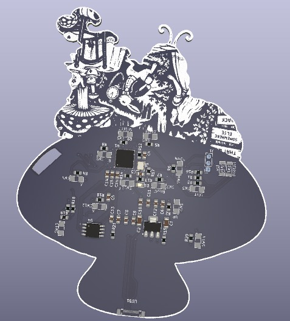</td>
  <td align="center" width="50%">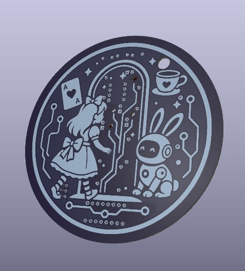</td>
</tr>
<tr>
  <td align="center"><b>badge, back</b> - the RP2040, flash, regulator and the button matrix</td>
  <td align="center"><b>soldering kit</b> - Alice, the White Rabbit and the looking glass</td>
</tr>
</table>

Each project carries its own `production/` directory with the fabrication
package: BOM, positions, designators and IPC netlist. See
[`hardware/README.md`](hardware/README.md) for opening, plotting and
re-fabricating the boards.

## The firmware

[`software/controller/`](software/controller) is the RP2040 firmware. It
presents the badge to a host as a **wired DualShock 4** (Sony's VID/PID; the
strings are the badge's own, which is how the site knows a badge from a stock
controller), which is what makes it work on an iPhone - iOS only binds
controllers it recognizes by USB VID/PID, so a generic HID gamepad enumerates
and is then ignored. Every other host understands the same report.

```
cd software/controller
mkdir build && cd build
cmake -DPICO_SDK_PATH=/path/to/pico-sdk ..
make -j                              # -> build/controller.uf2
```

<p align="center">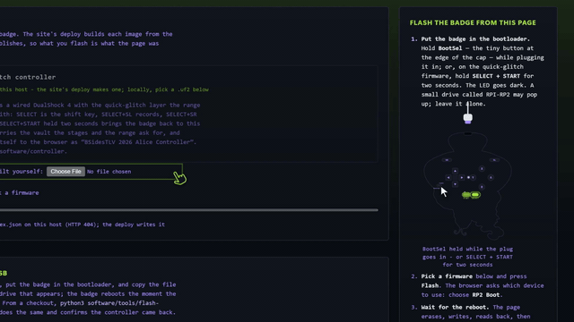</p>

Hold `BootSel` while plugging in USB-C, then copy `controller.uf2` onto the
`RPI-RP2` drive that appears - or let `python3 software/tools/flash-badge.py`
wait for the drive, copy, and confirm the controller came back (`--fetch`
takes the newest CI build, so no toolchain is needed). On this firmware,
`SELECT+START` held for two seconds reaches the bootloader without the button.
It also builds and runs on a stock Raspberry Pi Pico, which is the easiest way
to try the firmware without a badge.

Or from a browser: [`flash.html`](flash.html) on the site talks to the
bootloader over **WebUSB** - Chrome or Edge on a PC, a Mac, a Linux box or an
Android phone, nothing to install - and writes the image the deploy built. It
speaks PICOBOOT, the protocol `picotool` uses (`src/picoboot.js`), reads the
flash back before rebooting, and is tested against a model of the ROM by
`software/tools/verify-flash.mjs`. The page shows each step on the badge
drawn from the board: BootSel lit while a plug slides into the stalk, then
SELECT + START held, then any button so the browser lists it.

**The vault.** The last flash sector holds the stage key the challenge site
is sealed under. HID feature report `0xF1` - one the DualShock 4 descriptor
already declares, so iOS is unaffected - reads and writes it; `SELECT`+`Y`
held spells it on the stick axes for browsers without WebHID. Writes to a
keyed badge need `SELECT` physically held. `software/controller/src/vault.c`,
host-tested by `test/test_vault.c`; the site side is `src/vault.js`, proven
against `software/tools/fake-badge.mjs`.

**Quick glitch.** `SELECT` is a shift key. `SELECT+SL` records a take of button
presses with microsecond timestamps; `SELECT+SR` fires it - a `START` tap as
the trigger, a wait of `offset`, then the take at `speed`. `UP`/`DOWN` scale
the speed from 1/4x to 32x, `LEFT`/`RIGHT` step the offset in milliseconds,
`B` forgets it all. It is what the glitch range is played with. The engine is
plain C with a host test: `make -C software/controller/test`.

Full pin map, chord table and HID report layout:
[`software/controller/README.md`](software/controller/README.md). The
firmware, the vault, the flasher and the gate's unplug watch are proven
against host tests and models of the hardware; none has run on a board yet,
and `BADGE_GATE.md` §7 lists what to check first when one arrives.

## Licences

- **Software** - MIT, see [`LICENSE`](LICENSE). Covers `software/` and the
  Python/Node tooling under `hardware/soldering-kit/tools/`.
- **Hardware** - CERN-OHL-S-2.0, see [`hardware/LICENSE`](hardware/LICENSE).
  Covers both KiCad projects and every gerber, plot and production package
  under `hardware/`.

Third-party symbols and footprints vendored under
`hardware/badge/libs/lcsc/` keep their own upstream terms. The fonts embedded
in the promo under `software/promo/assets/fonts/` are under the SIL Open Font
License.

## Contributing

See [`CONTRIBUTING.md`](CONTRIBUTING.md). The easiest contribution is a room.
